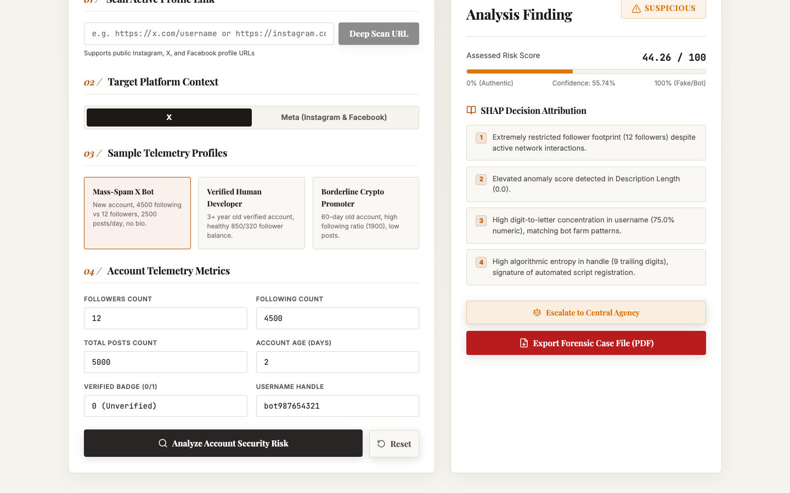

# Fake account detector


Live: https://fake-acc.vercel.app

A web tool that scores a social media account as real, suspicious or fake. It was built for Smart India Hackathon problem statement 1775 (ITBP / Ministry of Home Affairs). It only analyses accounts; it does not create or operate any.

You give it a profile's numbers (followers, following, posts, account age, bio length, username shape) or a profile URL. A gradient-boosted classifier returns a risk score, SHAP explains which features pushed the score, and a PDF case file can be exported. The same page can batch-score a CSV and track flagged accounts through a small case-review workflow.



## What is in it

- **Two classifiers.** XGBoost on 13 features for Twitter/X and on 7 features for Instagram/Facebook ("meta"). Models are in `models/saved/`. Features are listed in `models/predict.py`.
- **Explanations.** `models/predict.py` turns SHAP values into plain-language reasons.
- **URL scan.** `POST /analyze/url` drives a headless Chromium (Playwright) or Instaloader to read a public profile, then adds caption similarity and identity checks (display name versus handle) from `backend/content_analyser.py`, which uses the `all-MiniLM-L6-v2` sentence-embedding model. This part needs network access, the platforms' pages as they are today, and often a logged-in session. I did not run it for this cleanup; see Limitations.
- **Network graph.** `backend/network_analyser.py` builds a NetworkX graph of related accounts for the dashboard.
- **Case workflow.** `backend/cases.py` keeps flagged accounts in SQLite and only lets a case move forward one step: flagged, under review, report sent, takedown confirmed. The cases that appear at first start come from `backend/seed_cases.py` and are made up.
- **Batch CSV.** `demo_batch.csv` shows the expected columns.

## Models and data

The training tables are `data/processed/twitter_master.csv` (64,919 accounts) and `data/processed/meta_master.csv` (36,383 accounts). They were built by `feature_extractor/build_twitter.py` and `build_meta.py` from the CSVs in `data/raw/`, which come from public research datasets (the folder names refer to Cresci-2017, an IMFAD/LIMFADD set and several Kaggle uploads). I could not confirm download locations or licences for them, so check the licence of each before reusing them.

The Twitter human/bot dataset also shipped about 24,000 profile pictures of real users. No code reads them, so they were removed from the tree and are ignored in `.gitignore`. They are still in git history.

Training scripts are in `models/experiments/` (hyper-parameter search with 3-fold cross-validation, scored on F1 of the fake class).

### Results

Test split: 20% of each table, `random_state=42`, stratified, which is what the tuning scripts use. The saved XGBoost models, evaluated on that split during this cleanup:

| | Accounts in test split | Accuracy | F1 (fake class) | Accuracy / F1 recorded in `models/results.md` |
|---|---|---|---|---|
| Twitter / X | 12,984 | 89.82% | 86.00% | 90.04% / 85.63% |
| Meta | 7,277 | 96.72% | 97.02% | 96.87% / 97.15% |

The numbers are close but not identical to the recorded ones. I did not retrain, so I do not know whether the saved files predate the final run of the tuning script. `models/results.md` also lists a soft-voting ensemble that scores slightly higher. Its pickles are excluded by `.gitignore` and are not in the repo, so the app uses the tuned XGBoost models.

## Layout

```
backend/            FastAPI app: main.py (routes), cases.py, schemas.py, scrapers, content_analyser.py,
                    network_analyser.py, report_generator.py, session_manager.py
models/             predict.py (inference + SHAP), saved/ (models and scalers), experiments/, results.md
feature_extractor/  builds the processed tables from data/raw
data/               processed/ (tables used for training) and raw/ (source CSVs)
frontend/           React 18 + TypeScript + Vite single-page app
tests/              API and workflow tests
notebooks/          small scripts for inspecting data and sanity-checking predictions
```

## Run it locally

Python 3.12 and Node 20.

```bash
python3 -m venv .venv
.venv/bin/pip install -r requirements-dev.txt     # torch is a large download
.venv/bin/uvicorn backend.main:app --port 8000    # API docs at /docs, health check at /health

cd frontend && npm install && npm run dev         # http://localhost:5173
```

The frontend calls `http://localhost:8000` in dev. For a deployed frontend set `VITE_API_BASE` (see `frontend/.env.example`). After `npm run build`, the backend also serves `frontend/dist` itself.

For a URL scan you also need `playwright install chromium`.

### API

```bash
curl -X POST localhost:8000/analyze -H 'content-type: application/json' -d '{
  "platform": "twitter", "followers": 12, "following": 4500, "post_count": 5000,
  "verified": 0, "description_length": 0, "account_age_days": 2, "has_url": 1 }'
```

Other routes: `POST /analyze/batch`, `POST /analyze/batch/csv`, `POST /analyze/url`, `POST /analyze/report` (PDF), `/cases`, `/session/*`.

## Deployment

The frontend is the Vite app in `frontend/`, which `frontend/vercel.json` configures for Vercel. `render.yaml` describes the backend as a Render web service and the `Dockerfile` builds the whole app (frontend and backend) for a container host. The repo cleanup did not touch any of these files.

## Tests

```bash
.venv/bin/python -m pytest tests
cd frontend && npm run build
```

The nine API tests cover the health check, scoring on both platforms (an obvious bot scores above an obvious human), request validation, CSV batch scoring and the case state machine (no skipping, no reopening a closed case, run against an in-memory database). CI runs these and the frontend build.

## Limitations

- The classifiers see only account counts and username shape. On the built-in "Mass-Spam X Bot" sample (12 followers, 4,500 following, 2 days old, 5,000 posts) the model answers "suspicious" at about 44, not "fake". Treat the score as a triage signal.
- Live scraping depends on the platforms' markup and rate limits, and it uses a session cookie that the operator pastes in or captures from their own login. Scraping may be against a platform's terms. The scrapers were not exercised during the cleanup.
- The PDF case file follows the layout of a Section 65B certificate, but nobody has reviewed it legally. The escalation workflow is a demo with made-up cases and is not connected to any agency or platform.
- The training data is a mix of public datasets whose labels were not independently checked. Accuracy on accounts from a different period or platform behaviour may be lower.
- `backend/main.py` still uses the Pydantic v1 `.dict()` call, which warns under Pydantic 2.

## License

MIT, see [LICENSE](LICENSE).
